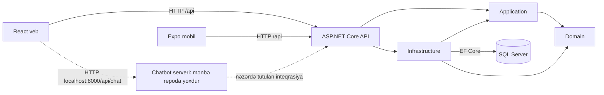
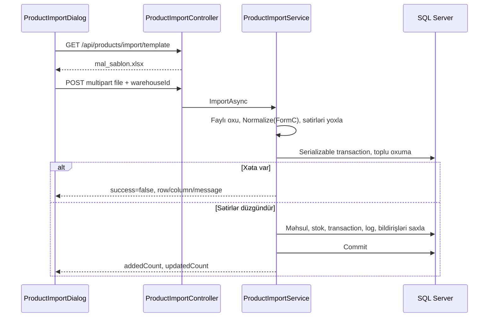

# Stockroom arxitekturası

Kod yoxlaması: 2026-10-29. Naməlum seçimlərin səbəbi ayrıca TODO ilə göstərilir.

## Modullar və əlaqələr

Oxlar project reference və HTTP əlaqəsini göstərir. Chatbot serverinin faktiki davranışı yoxlanmayıb.

| Qovluq | Vəzifə | Giriş nöqtəsi / nümunə |
|---|---|---|
| `src/StockManagement.Domain` | Entity, enum, state qaydaları | `Entities/Product.cs`, `Services/PurchaseOrderStateMachine.cs` |
| `src/StockManagement.Application` | DTO, validation, repository interfeysləri, tətbiq xidmətləri | `Products/ProductService.cs`, `Security/Roles.cs` |
| `src/StockManagement.Infrastructure` | EF, SQL, Identity, xidmətlərin reallaşdırılması | `Persistence/StockManagementDbContext.cs`, `DependencyInjection.cs` |
| `src/StockManagement.Api` | HTTP route, auth, DI, Swagger | `Program.cs`, `Controllers/` |
| `client/src` | Veb ekranları və HTTP çağırışları | `App.tsx`, `ProductImportDialog.tsx`, `ChatWidget.tsx` |
| `mobile` | Expo tətbiqi | `App.tsx` |
| `tests/StockManagement.Tests` | xUnit testləri | `ProductImportTests.cs`, `SwaggerTests.cs` |

Domain başqa project-ə reference vermir. Application Domain-dən asılıdır.
Infrastructure Application və Domain-ə, API isə Application və Infrastructure-a reference verir.
Backend hamısı `net9.0` hədəfləyir.
Bu, qatlı quruluşdur; bütün biznes məntiqi Application-da deyil.
PO, GRN və Excel idxalı kimi xidmətlərin bir hissəsi Infrastructure-dadır.
Bəzi controller-lər də birbaşa DbContext-dən istifadə edir; məsələn `ChatbotDataController`.

## Bir sorğu necə işləyir?

Məhsul redaktəsi üçün nümunə:

1. React formu istifadəçinin dəyərlərini toplayır.
2. `App.tsx` JSON və Bearer access token ilə `PUT /api/products/{id}` göndərir.
3. API middleware tokeni və controller-in tələb etdiyi permission-u yoxlayır.
4. `ProductsController` FluentValidation ilə sorğunu yoxlayır.
5. `ProductService` məhsulu və SKU/barkod uyğunluğunu yoxlayır.
6. `EfProductRepository` eyni sorğunun scoped DbContext-i ilə SQL-ə yazır.
7. DTO JSON kimi qayıdır. Veb siyahısı yenilənir.

DI qeydiyyatı `AddApplication` və `AddInfrastructure` vasitəsilə `Program.cs`-də çağırılır.
Repository və əksər xidmətlər scoped-dur: bir HTTP sorğusu daxilində paylaşılır.

## Stok üçün bir neçə məlumat yolu var

| Model | Kodda istifadəsi |
|---|---|
| `Product` | Ad, SKU, kateqoriya, satış qiyməti, əlavə `Stock` və `AverageCost` sahələri |
| `Stock` | Məhsul + anbar üzrə `Quantity`; kataloq qalığı bu qeydlərdən cəmlənir |
| `ProductBatch` | Partiya nömrəsi, qalıq, giriş/son istifadə tarixləri, alış/satış qiyməti |
| `StockTransaction` | Purchase/Sale/Adjustment tipli əməliyyatlar |
| `StockMovement` | Ledger hərəkətləri; GRN və stok sənədi axınlarında işlənir |
| `StockLog` | Miqdarın əvvəl/sonra vəziyyəti və əməliyyatı edən istifadəçi |
| `AuditLog` | Biznes əməliyyatlarının audit qeydi |

`EfInventoryRepository.ReceiveAsync` partiya və stok yaradır/artırır.
`IssueFifoAsync` giriş tarixinə görə köhnə partiyaları əvvəl sərf edir.
`ProductBatch` konstruktoru tam və ən azı 1 miqdar tələb edir; Excel idxalı isə 3 onluq rəqəmə icazə verir.
Excel idxalı və admin qalıq düzəlişi partiya yaratmır.
Bu səbəbdən ümumi stok ilə FIFO üzrə çıxarıla bilən stok eyni olmaya bilər.
TODO: dəqiqləşdir — bütün axınlar üçün vahid stok mənbəyi və uzlaşdırma siyasəti.

## Satınalma və qəbul

`Supplier` təchizatçını, `PurchaseOrder` sifarişi, `PurchaseOrderItem` məhsul sətirlərini saxlayır.
PO statusları: `draft`, `pending_approval`, `approved`, `partially_received`, `received`, `cancelled`.
`PurchaseOrderService` keçidləri və icazələri idarə edir.
`GoodsReceiptService` təsdiqlənmiş PO əsasında qəbulu, idempotency açarını və reverse əməliyyatını işləyir.
Qəbul olunan və qüsurlu miqdarlar ayrıca saxlanır. Bu davranışa aid uğursuz testlər [PLAN](../PLAN.md)-dədir.
Əlavə məlumat: [procurement qeydləri](procurement-notes.md).

## Excel idxalı

Mövcud SKU üçün yalnız ad və qiymət yenilənir; miqdar seçilən anbardakı qalığa əlavə edilir.
Yeni məhsulun SKU-su import yolu daxilində olduğu kimi qorunur.
İdxal FIFO partiyası və alış maya dəyəri yaratmır. Təkrar uğurlu idxal miqdarı yenidən əlavə edə bilər.
Veb eyni əməliyyatın davam etdiyi müddətdə təkrar göndərişi bloklayır.
Bu, backend idempotency zəmanəti deyil.
Məhdudiyyətlər və istifadə: [Excel idxalı](product-import.md).

## Giriş və konfiqurasiya

- Identity istifadəçi/rolları saxlayır. JWT `role` və `permission` claim-ləri yoxlanır.
- Policy-lər `Program.cs`, rol default-ları `Application/Security/Roles.cs` daxilindədir.
- Veb sessiyası `sessionStorage`, mobil sessiya `expo-secure-store` ilə saxlanır.
- `refresh-token` üçün access token yeniləmə məntiqi mövcuddur.
- `AllowAnonymous` giriş route-larında, kök redirect-də və `ChatbotDataController`-də istifadə olunur.
- CORS lokal frontend origin-ləri üçün konfiqurasiya edilir. Swagger yalnız Development-də açılır.
- `DemoDataSeeder` və `AuthSeeder` başlanğıcda çağırılır. Demo seed Production şərti ilə məhdudlaşdırılmayıb.
- `ConnectionStrings__StockManagementDb`, `Jwt__SigningKey`, `Auth__BootstrapAdmin__*` konfiqurasiyanın əsas açarlarıdır.

Production deployment, chatbot serveri və backup infrastrukturu repoda müəyyən edilməyib: TODO: dəqiqləşdir.
Mövcud ADR-lərdəki köhnə rol izahları cari permission xəritəsi ilə tam uyğun deyil; cari kod əsas götürülür.
